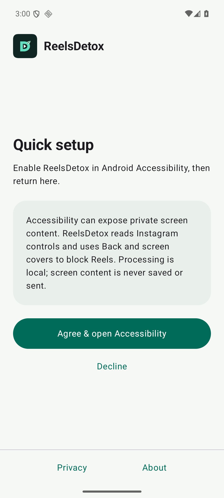

# ReelsDetox

A local-only, open-source Android experiment for reducing Instagram Reels without intentionally blocking the rest of Instagram. Kotlin · Jetpack Compose · Material 3 · MIT.

**Status: experimental, with limited physical-device validation.** On a Pixel 8 running Android 17 and Instagram 452.1.0.53.64, the lower Reels tab was covered and 20 repeated taps did not enter Reels; with button covering temporarily disabled, 10 repeated entries returned to Home. Other devices, versions and entry routes remain unverified. See [feasibility and evidence limits](docs/feasibility.md).

## Features implemented

- **Complete Blocking:** immediate Back on a newly detected Reels viewer, with a temporary opaque viewer guard and at most one retry; no app kill or Home action.
- **Daily Time Limit:** 1–120 minutes, local daily totals, monotonic viewing time, midnight/DST handling, restart persistence and timezone quota carry.
- **Optional Reels button cover:** a touch-consuming accessibility overlay positioned from validated node bounds, only while blocking applies. This visually covers the button; it does not remove it.
- English-only UI regardless of device language, light/dark Material 3 interface, one-screen consent setup, spacious dashboard, settings, privacy and about.
- Disable protection and withdraw consent at any time. No Internet permission, account, backend, analytics, ads or accessibility-content storage.

## App preview

Actual English UI captured on the Android 16 test emulator:

 

## Build

Use JDK 17, Android Studio compatible with AGP 9.2.1, and the Android SDK. Install SDK Platform **37.0**, Build Tools **36.0.0** and platform-tools. For command-line setup:

```sh
sdkmanager 'platforms;android-37.0' 'build-tools;36.0.0' 'platform-tools'
# Set ANDROID_HOME to your SDK, or create an untracked local.properties with sdk.dir.
./gradlew :core:test :app:testDebugUnitTest :app:lintDebug :app:assembleDebug :app:assembleDebugAndroidTest
```

The Gradle 9.4.1 wrapper is included and its distribution checksum is pinned. Gradle downloads build dependencies on first use. Application networking is not enabled. The minimum OS is Android 8/API 26 for native `java.time`; compile/target SDK is API 37. Dependencies are pinned in `gradle/libs.versions.toml`.

APK: `app/build/outputs/apk/debug/app-debug.apk`. [Install on Pixel 8 and enable accessibility](docs/installation.md). This is development signing, not a production release. CI builds/tests each PR and main push and uploads the debug APK. Device tests run with `./gradlew :app:connectedDebugAndroidTest` on a dedicated emulator/test installation.

## Structure

```text
core/src/main/kotlin/dev/reelsguard/core/   classifiers, domain models, policies, daily ledger
core/src/test/                            deterministic behavioral tests
app/src/main/java/dev/reelsguard/
  data/                                   DataStore settings and durable counter codec
  monitoring/                             accessibility adapter, service actor and live status
  overlay/                                bounded accessibility window cover
  ui/                                     Compose screens and theme
app/src/main/res/values/                   English-only strings
app/src/androidTest/                      consent UI and storage instrumentation tests
.github/workflows/android.yml             tests, lint, build and APK artifacts
docs/                                    feasibility, installation, manual tests and validation
```

`core` has no Android dependencies. The Android service owns the mutable usage tracker and serializes processing on the main thread. DataStore performs disk I/O off the main thread. Manual dependency injection keeps one repository per application. StateFlow connects stored settings and live service status to Compose.

## Important limits

- Candidate view IDs are not official Instagram APIs. No version is currently declared supported. Unknown/hidden/ambiguous trees fail open to protect DMs, Stories, profiles and ordinary posts.
- All Reels entry routes share viewer classification; external links may have no previous Instagram screen in Android's back stack. Back can return to the originating app. ReelsDetox does not force-stop Instagram.
- Button covers require an exact navigation ID and safe bounds. Viewer detection also accepts exact action labels in English, Hungarian, German, French, Spanish, Italian and Portuguese. Other languages or Instagram versions may affect detection; the exact navigation ID itself is language-independent. API 26–29, secondary displays and ambiguous windows use safe fallbacks. Event scheduling leaves a small unavoidable cleanup race.
- Process termination may lose roughly the last one-second checkpoint plus I/O latency. Force-stop or revoked access can stop protection; saved usage remains. Clearing data/uninstalling resets it by design.
- Clock edits are handled conservatively. Timezone changes carry quota, and wall-clock edits do not move the same-boot reset schedule. Offline time cannot be made tamper-proof.
- A successful Back request is not proof that Instagram exited its viewer. A second attempt is allowed after 250 ms within the same episode; a confirmed new entry has no inherited cooldown. A viewer still open after both attempts remains covered and is reported, without an endless Back loop.

[Validation results](docs/validation.md) · [manual test matrix](docs/manual-testing.md) · [privacy](PRIVACY.md) · [security](SECURITY.md) · [contributing](CONTRIBUTING.md).

## Distribution and next steps

GitHub builds are for testers. Google Play distribution requires its own accessibility declaration, prominent disclosure review, Data Safety answers, signing and policy approval. `isAccessibilityTool=false`: this is a wellbeing tool, not an aid designed for disabilities.

Priorities for v1.1:

1. Validate/adapt recognition on a physical Pixel 8 and record sanitized fixtures for every entry route and false-positive case.
2. Exercise lifecycle/overlay transitions across Android versions, navigation modes, rotations, large fonts and OEM power policies.
3. Add optional local diagnostic reason codes without screen-content logging, plus adapter version reporting.
4. Establish protected release signing, reproducible release provenance and a stable update channel before wider distribution.

Independent project; not affiliated with Instagram or Meta. MIT license; see [LICENSE](LICENSE).

The existing Android application ID is retained for in-place upgrades; the installed app and repository are named ReelsDetox.
