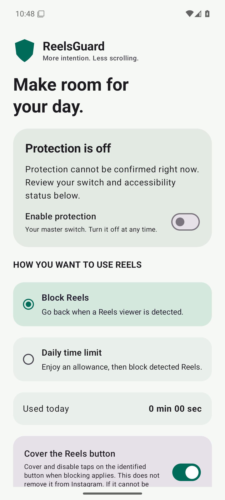
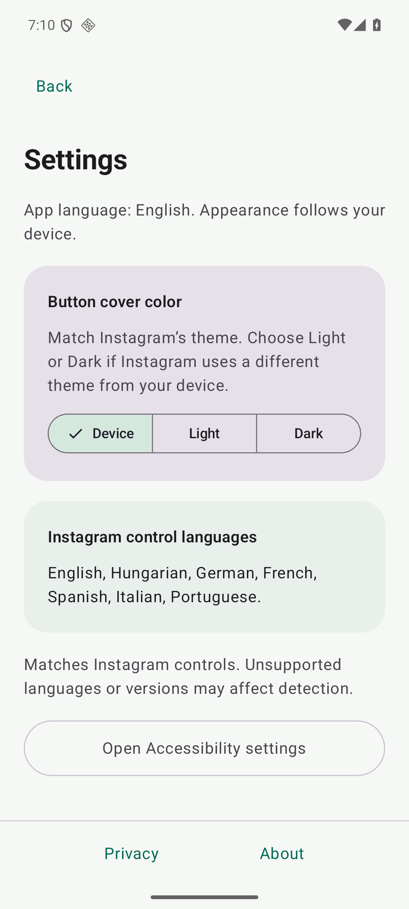

# ReelsDetox

Spend less time on Instagram Reels.

ReelsDetox is a free, open-source Android app that blocks Reels or sets a daily time limit, while letting you keep using the rest of Instagram.

**[Download the APK](https://github.com/L3068/ReelsDetox/releases)** · [Installation help](docs/installation.md)

Android 8 or later · No root required · Experimental builds

## Get started

1. Download the `.apk` file from [Releases](https://github.com/L3068/ReelsDetox/releases) and install it on your phone.
2. Open ReelsDetox and tap **Agree & open Accessibility** after reading the disclosure.
3. Enable **ReelsDetox protection** in Android Accessibility settings, then return to the app.
4. Choose **Block Reels** to block viewing, or **Daily time limit** to allow 1–120 minutes per day.

If Android prevents enabling the service, see [restricted settings help](docs/installation.md#restricted-settings).

## Make it yours

- Turn on **Cover Reels button** to hide the Reels shortcut while blocking applies.
- Match Instagram's appearance in **Settings → Button cover color**: Device, Light or Dark.
- Turn protection off at any time using the dashboard switch.

 

## Privacy

Accessibility access can expose private screen content. ReelsDetox uses Instagram controls to recognize Reels, return from blocked videos and cover the Reels button. Processing stays on your phone; screen content is not saved or sent. The app has no Internet permission, ads or analytics.

[Read the privacy policy](PRIVACY.md).

## Compatibility and help

ReelsDetox is experimental. Instagram updates, languages and device differences can affect blocking. The app interface is in English. See [known limitations](docs/feasibility.md) and [test results](docs/validation.md).

[Report a problem](https://github.com/L3068/ReelsDetox/issues), including your Android and Instagram versions and how you opened the Reel.

## For developers

[Build and contribute](CONTRIBUTING.md) · [Manual testing](docs/manual-testing.md) · [Security](SECURITY.md)

Licensed under the [MIT License](LICENSE). Independent project; not affiliated with Instagram or Meta.
